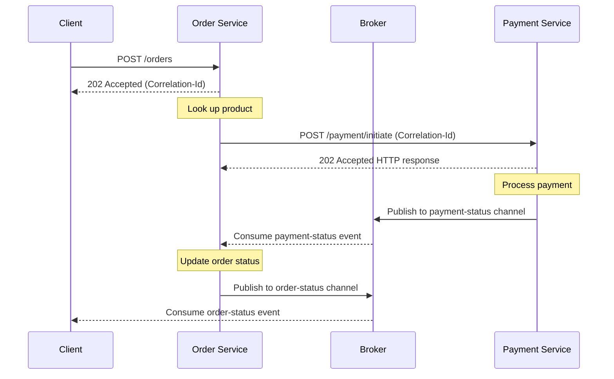

# Supporting Interfaces

This sample demonstrates contract testing an Order Service whose behaviour spans HTTP and asynchronous events.
Specmatic tests the Order Service through its OpenAPI contract and its supporting AsyncAPI interface,
while using the dependency i.e. payment service’s OpenAPI and AsyncAPI contracts to run mocks.

## How it works

The Order Service processes orders asynchronously. It acknowledges incoming requests immediately and uses a shared `Correlation-Id` to correlate HTTP requests and Kafka events throughout the order lifecycle.



### Execution flow

1. **Create order:** The client sends a `POST /orders` request. The Order Service immediately returns a `202 Accepted` response with a `Correlation-Id`.
2. **Initiate payment:** The Order Service looks up the product and asynchronously calls `POST /payment/initiate`, propagating the same `Correlation-Id`.
3. **Process payment:** The Payment Service processes the payment and publishes an event to the payment status channel in Kafka.
4. **Update order:** The Order Service consumes the payment status event, identifies the corresponding order using the `Correlation-Id`, updates its status, and publishes an event to the order status channel.
5. **Observe order status:** The client observes the order status channel for an event matching the `Correlation-Id` received in the initial HTTP response.

## Run the contract tests

Requirements:
- Docker Desktop with the Compose plugin.
- Python 3.13 or later and [uv](https://docs.astral.sh/uv/)

Install the Python dependencies:

```shell
uv sync --locked
```

Run the contract test:

```shell
uv run pytest -s tests/contract
```

The contract test uses Docker Compose to build and start the Order Service alongside Specmatic,
run the test suite, and clean up the containers and volumes afterward.

## HTML reports

After running the contract tests, open the generated reports:

- [OpenAPI contract test report](build/reports/specmatic/test/html/index.html)
- [OpenAPI mock report](build/reports/specmatic/stub/html/index.html)
